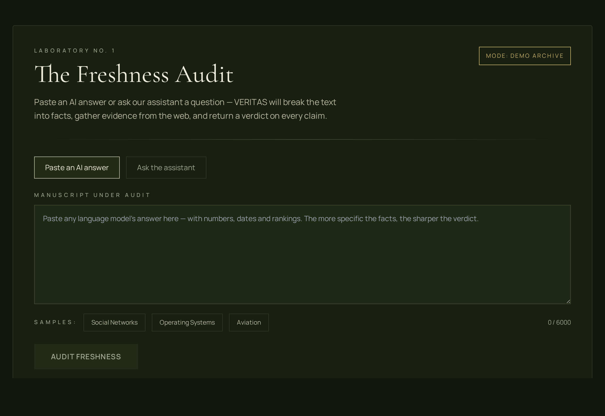
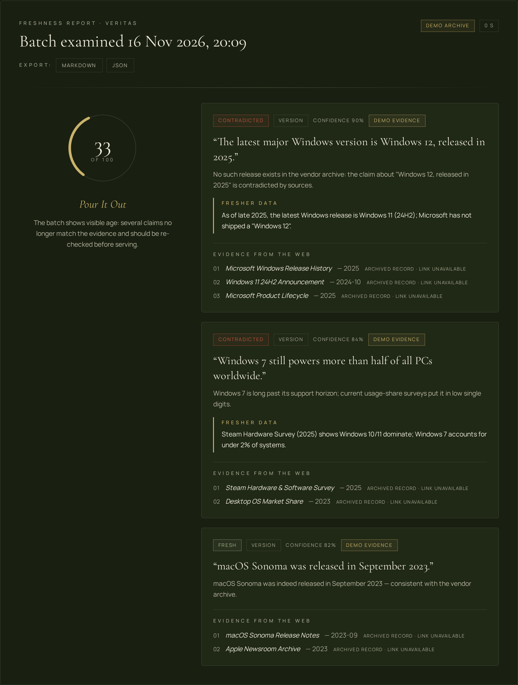

<div align="center">

# V E R I T A S

**The Freshness Atelier for AI Answers**

*Truth has a shelf life. VERITAS stamps the date.*

[](#architecture)
[](#architecture)
[](#how-the-audit-works)
[](#architecture)

**Built for the Geek Room Global AI Hackathon 2026 — Tavily Track**
*“Build a Stale-Answer Detector for AI Applications”*

---

</div>

AI models answer in fluent, confident prose — but the world they describe was frozen at their training cutoff. VERITAS is a **stale-answer detector**: paste any AI answer, and the atelier extracts its checkable claims, verifies each one against **dated evidence from the live web** via Tavily, and pours the whole batch into a single **0–100 freshness index** — with a verdict, a confidence score and real sources for every claim. No “take our word for it”. Only dated evidence.

---

## The problem: AI answers age silently

An AI answer looks identical the day it is right and the day it is wrong. Nothing in the text announces its vintage — no date, no source, no shelf life. When stale facts escape into the wild, they have consequences:

| Evidence | What happened | Source |
|---|---|---|
| **58–82%** | Share of responses hallucinated by general-purpose LLMs on specific legal queries | [Stanford RegLab, *Large Legal Fictions* (2024)](https://arxiv.org/abs/2401.01301) |
| **$5,000 fine** | Lawyers sanctioned for filing six fabricated case citations generated by ChatGPT | [*Mata v. Avianca*, S.D.N.Y. (June 2023)](https://www.law.berkeley.edu/wp-content/uploads/archive/2025/12/Mata-v-Avianca-Inc.pdf) |
| **$812.02 CAD** | Damages a tribunal ordered Air Canada to pay after its chatbot invented a refund policy | [BC Civil Resolution Tribunal (Feb 2024)](https://www.bbc.com/travel/article/20240222-air-canada-chatbot-misinformation-what-travellers-should-know) |

The pattern never changes: **confident text, outdated or invented facts — and no dates anywhere.** Re-generation cannot fix this: the model does not know what changed after its cutoff. Only live, dated evidence can.

## How the audit works

| Step | What happens |
|---|---|
| **01 · Extract the claims** | A dependency-free splitter pulls up to five checkable sentences from the answer and tags each one: ranking, statistic, version, date or status. |
| **02 · Search the live web** | The [Tavily Search API](https://tavily.com) gathers up to four dated sources per claim; snippets are kept verbatim as evidence. |
| **03 · Judge the freshness** | An LLM assessor reads *claim vs. evidence* and replies in strict JSON: `FRESH`, `STALE`, `CONTRADICTED` or `UNCONFIRMED`. A publication-date heuristic stands guard as a fallback, so the audit never breaks. |
| **04 · Bind the report** | Verdicts, confidence scores, fresher facts and evidence merge into one 0–100 freshness index. A full batch audit completes in about three seconds. |

## The verdict scale — poured like wine

| Verdict | Score | Cellar label | Meaning |
|---|---|---|---|
| `FRESH` | **100** | *Fit to Bottle* | Recent sources corroborate the claim; nothing fresher contradicts it. |
| `UNCONFIRMED` | **50** | *Cellar With Care* | Evidence is missing or irrelevant; the claim stays unproven, not refuted. |
| `STALE` | **15** | *Pour It Out* | The fact has aged or drifted since the answer was written. |
| `CONTRADICTED` | **0** | *Unfit to Bottle* | The freshest sources directly refute the claim. |

The batch index is the average across claims, rendered on one gauge — from *Fit to Bottle* to *Unfit to Bottle*.

## Product tour

<div align="center">

**The Laboratory** — paste an AI answer or ask the built-in assistant; five crafted samples make the demo one click deep.



**The Report** — every claim gets a verdict chip, a confidence score, a plain-language explanation, a *Fresher Data* block with the corrected fact, and a numbered evidence list with source years.



</div>

## Architecture

| Layer | Choice | Notes |
|---|---|---|
| Frontend | React 18 · Vite · Tailwind | The atelier itself: laboratory, process, archive. |
| API server | Node · Express | `POST /api/audit` — claims in, verdicts out. |
| Evidence | Tavily Search API | Dated live sources for every claim. |
| Assessor | Any OpenAI-compatible LLM | Temperature 0, strict-JSON verdicts; the endpoint is configurable, so any gateway drops straight in. |
| Fallback | Publication-date heuristic | If the model is unreachable, verdicts stay conservative — never broken. |
| Privacy | Server-side `.env` | Keys never reach the browser or the repository. |

```
veritas-hack/
├── server/server.mjs      # live-mode server: /api/health, /api/audit
├── src/
│   ├── lib/extract.js     # claim extraction & classification (shared)
│   ├── lib/demoEngine.js  # honest demo mode without any keys
│   ├── lib/api.js         # audit client with staged progress
│   └── components/        # Hero, Lab, Report, Archive, Process…
├── docs/                  # screenshots
└── .env.example           # copy as .env and add your keys
```

## Quickstart

```bash
# 1. install
npm install

# 2. configure
cp .env.example .env
#    TAVILY_API_KEY=tvly-…        → enables LIVE mode
#    LLM_API_KEY / LLM_BASE_URL / LLM_MODEL   (optional)
#      any OpenAI-compatible endpoint: Groq, OpenRouter, Gemini, …

# 3. build & serve (http://localhost:8787)
npm run build
npm start
```

For frontend development use `npm run dev` (Vite on :5173) alongside `npm start`.

| Mode | Trigger | Behaviour |
|---|---|---|
| **Live Web** | `TAVILY_API_KEY` present | Real Tavily searches; LLM assessor if configured, date-heuristic otherwise. |
| **Demo Archive** | no key | Runs honestly on a synthetic evidence archive — every interactive feature still works. |

## The road ahead

- **Now — hackathon prototype:** web laboratory with paste & ask modes, live Tavily audits with LLM assessor, heuristic fallback, demo archive.
- **Next — product surface:** REST API so any app can call the audit; a browser extension that scores AI text on any page; a gateway plugin so LLM responses carry freshness headers.
- **Later — ecosystem:** freshness dashboards for content teams, claim-level evidence inside chat UIs, multilingual claims and regional sources.

---

<div align="center">

**The question is no longer whether AI can write it — but whether it is still true.**

*VERITAS · AI INATOR · Geek Room Global AI Hackathon 2026, Tavily Track*

Working prototype — the laboratory, the live audit and the archive are ready for the jury.

</div>
